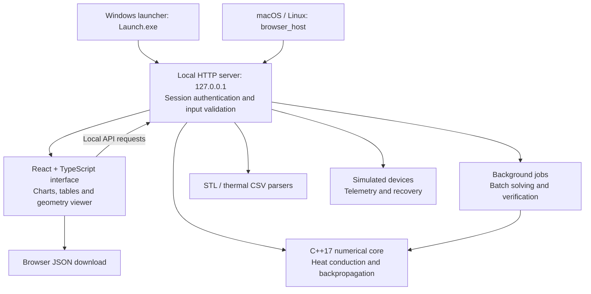

# Thermal Atlas

Thermal Atlas is an offline engineering workbench for exploring heat conduction and numerical verification. Its C++17 solver computes temperatures along a rod and compares four finite-element meshes against an analytical solution. A local React interface plots temperatures and convergence, displays STL geometry and thermal CSV data, and exports computed results.

The workbench also compares serial and parallel batches, checks backpropagation gradients using finite differences, and simulates device connection and recovery. A Windows launcher starts the local service and opens the interface in the browser.

## Architecture

The application runs on your computer: the launcher starts a local server, which serves both the browser interface and the C++ calculation API.



Calculations and runtime assets stay local; hardware telemetry is simulated. See [the detailed architecture](docs/ARCHITECTURE.md) for component responsibilities, request flow, security controls and verification.

## Run on Windows 11 — no installation

1. [Download the Windows application ZIP](https://drive.google.com/file/d/11J7EYWGuj1tcgNZ1CyMq7D7HnePdDDJ3/view?usp=sharing). GitHub’s **Code → Download ZIP** contains the source files and requires the build steps below.
2. Right-click the application ZIP, choose **Extract All**, and open the extracted folder. Keep `Launch.exe` beside the `web` and `data` folders.
3. Double-click **Launch.exe**. If SmartScreen prompts and you trust this download, choose **More info → Run anyway**. The launcher opens Thermal Atlas in your default browser. Leave the launcher running while using the app.
4. Open **Thermal**, leave **Mesh elements** at **10**, and click **Run experiment**. The temperature plot should appear with a midpoint error of **1.25 °C**. Click **Export JSON** and check your downloads for `workbench-result.json`.
5. To try the 3D view, open **Geometry** and select `data/thermal_rod.csv` from the extracted folder. To stop the local service, click **Quit** in the launcher.

## Build from source

Install Git, Node.js 22.19 or later in the 22.x series, npm, CMake 3.20 or newer, and a C++17 compiler. On Windows use Visual Studio 2022 with **Desktop development with C++**. For the macOS/Linux commands below, install Ninja. The dependency installation needs internet access; the built application runs locally.

Clone the project and build the interface first on all platforms:

```sh
git clone https://github.com/tulasiram2005/thermal-atlas-workbench.git
cd thermal-atlas-workbench
npm --prefix web ci
npm --prefix web run build
```

**Windows (PowerShell)** — configure, compile, run tests, then launch:

```powershell
cmake -S . -B build -G "Visual Studio 17 2022" -A x64
cmake --build build --config Release --parallel
ctest --test-dir build -C Release --output-on-failure
.\build\Release\Launch.exe
```

**macOS or Linux (Terminal)** — use the local browser host:

```sh
cmake -S . -B build -G Ninja -DCMAKE_BUILD_TYPE=Release
cmake --build build --parallel
ctest --test-dir build --output-on-failure
./build/browser_host ./web/dist
```

Open the complete local URL printed in Terminal in a browser on the same computer. It signs you into that local session. Keep the URL private. Leave Terminal open while using the app and press Enter there to stop it.
