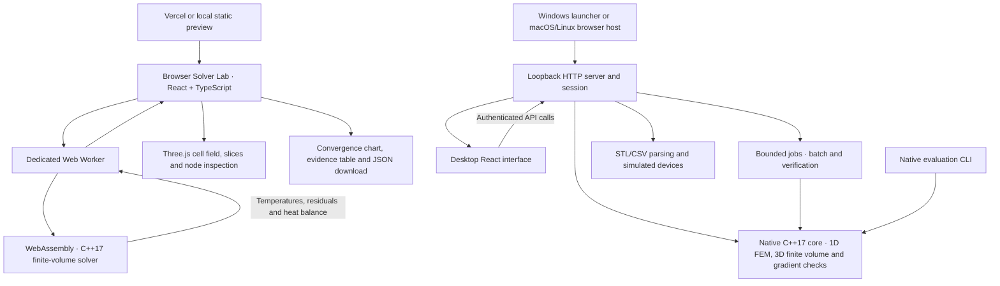

# Thermal Atlas

[Open the live Solver Lab](https://thermal-atlas-workbench.vercel.app/) · [Download the complete source ZIP](https://github.com/tulasiram2005/thermal-atlas-workbench/archive/refs/heads/main.zip) · [Architecture guide](docs/ARCHITECTURE.md)

Thermal Atlas is an engineering workbench for studying steady heat conduction. Its **browser Solver Lab** compares three numerical methods on the same solid. Its **desktop workbench** adds a one-dimensional rod experiment with an analytical reference, STL and thermal CSV inspection, serial and parallel batch comparisons, gradient checks, and simulated device connection and recovery.

## Try a first experiment

1. Open the [live demo](https://thermal-atlas-workbench.vercel.app/). Calculations run on your device.
2. Leave **Constricted block** and grid **6** selected, then choose **Compare solvers**. The default problem has 152 active cells. Jacobi, Gauss–Seidel and diagonal PCG reach the residual tolerance in 169, 86 and 21 iterations respectively.
3. Select a solver card to inspect its temperature field. Choose a slice axis and move the slider to expose interior cells. Use **Next node** to read a cell's coordinates and temperature. The iteration slider under the chart reports each solver's residual.
4. Choose **Export evidence** to download the completed study as JSON. If you change the geometry or grid, compare again to enable export for the new settings.

Iteration counts describe convergence on the chosen mesh. Browser solve times are single observations and depend on the device. The constricted-block result still depends on mesh resolution.

## Run the browser edition on your laptop

**Requirements:** Node.js 22.19 or later in the 22.x series, npm, and a modern browser. The source includes the compiled WebAssembly module. A C++ compiler is only required for the native workbench.

Download and extract the [source ZIP](https://github.com/tulasiram2005/thermal-atlas-workbench/archive/refs/heads/main.zip). Open a terminal in the extracted **thermal-atlas-workbench-main** folder containing `CMakeLists.txt` and `web/`. Alternatively, use Git:

```sh
git clone https://github.com/tulasiram2005/thermal-atlas-workbench.git
cd thermal-atlas-workbench
```

From the project root, run these commands on Windows, macOS or Linux:

```sh
npm --prefix web ci
npm --prefix web run build:demo
cd web
npm exec -- vite preview --outDir dist-demo --host 127.0.0.1
```

Open the **Local** URL printed in the terminal (normally `http://127.0.0.1:4173`). Keep the terminal open and press **Ctrl+C** to stop the preview. Serve the built folder over HTTP so the browser can load its worker and WebAssembly files. Dependency installation requires internet access. After setup, the local preview runs offline.

## Architecture



Both 3D editions use the same C++ solver source. Vite builds the browser edition into `web/dist-demo` and the desktop interface into `web/dist`. The desktop server binds to the local machine. [Component map, request flows and verification](docs/ARCHITECTURE.md)

## Run the original Windows 11 package

1. The linked first-round binary does **not** include the new Solver Lab; build the current source below for the extension. [Download the original Windows application ZIP](https://drive.google.com/file/d/11J7EYWGuj1tcgNZ1CyMq7D7HnePdDDJ3/view?usp=sharing). GitHub’s **Code → Download ZIP** contains the source files and requires the build steps below.
2. Right-click the application ZIP, choose **Extract All**, and open the extracted folder. Keep `Launch.exe` beside the `web` and `data` folders.
3. Double-click **Launch.exe**. If SmartScreen prompts and you trust this download, choose **More info → Run anyway**. The launcher opens Thermal Atlas in your default browser. Leave the launcher running while using the app.
4. Open **Thermal**, leave **Mesh elements** at **10**, and click **Run experiment**. The temperature plot should appear with a midpoint error of **1.25 °C**. Click **Export JSON** and check your downloads for `workbench-result.json`.
5. To try the 3D view, open **Geometry** and select `data/thermal_rod.csv` from the extracted folder. To stop the local service, click **Quit** in the launcher.

## Build the current desktop workbench from source

Install Git, Node.js 22.19 or later in the 22.x series, npm, CMake 3.20 or newer, and a C++17 compiler. On Windows use Visual Studio 2022 with **Desktop development with C++**. For the macOS/Linux commands below, install Ninja. The dependency installation needs internet access; the built application runs locally.

Extract the source ZIP or clone the repository as described above. Start in the project root (if you are still in `web/`, run `cd ..`). Build the desktop interface before configuring CMake:

```sh
npm --prefix web ci
npm --prefix web run build
```

**Windows (PowerShell)** — configure, compile, run tests, then launch:

```powershell
cmake -S . -B build -G "Visual Studio 17 2022" -A x64
cmake --build build --config Release --parallel
ctest --test-dir build -C Release --output-on-failure
.\build\Release\Launch.exe
```

**macOS or Linux (Terminal)** — use the local browser host:

```sh
cmake -S . -B build -G Ninja -DCMAKE_BUILD_TYPE=Release
cmake --build build --parallel
ctest --test-dir build --output-on-failure
./build/browser_host ./web/dist
```

Open the complete local URL printed in Terminal in a browser on the same computer. It signs you into that local session. Keep the URL private. Leave Terminal open while using the app and press Enter there to stop it.

## Reproduce the 3D evaluation

After building, run `./build/solver_evaluate` on macOS/Linux, or `.\build\Release\solver_evaluate.exe` on Windows. Redirect its JSON output to a file: `./build/solver_evaluate > evaluation.json` (PowerShell: `.\build\Release\solver_evaluate.exe | Out-File -Encoding utf8 evaluation.json`). The study compares aligned grids of 6, 12 and 24 cells per axis with warm-up and five measured batches. Timings depend on your hardware; no cloud account is needed.

## Limitations

Hardware telemetry is simulated. The 3D geometry uses Cartesian cells, not a general CAD mesh. Solver timings exclude assembly and browser rendering. The built app needs no external runtime requests; installing build dependencies needs internet access.
