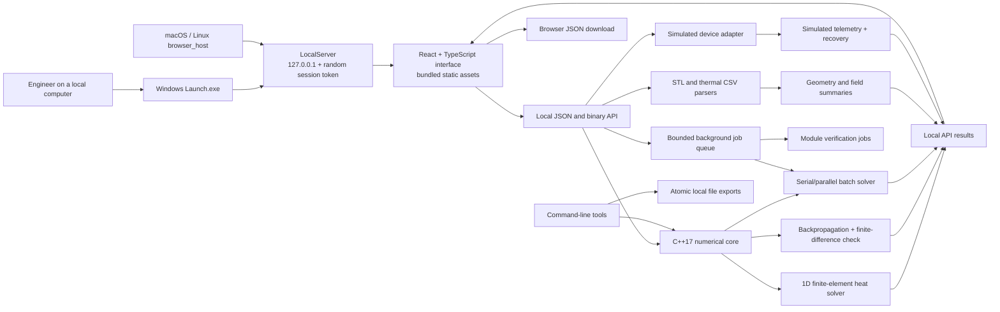
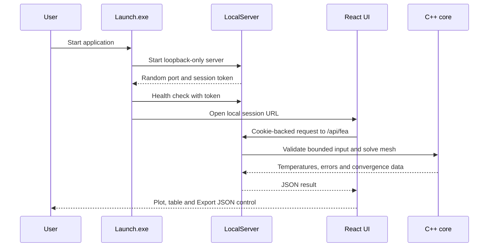
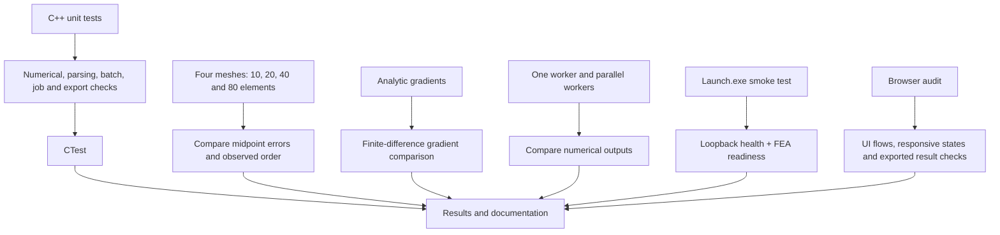

# Thermal Atlas architecture

Thermal Atlas is a local-first engineering workbench. The numerical core is kept
independent from the HTTP server, browser interface and operating-system launcher
so that numerical work can be tested without a browser or network dependency.

## System overview

## Local request flow

## Component responsibilities

| Layer | Main files | Responsibility |
|---|---|---|
| Numerical core | `src/core/numerics.*` | 1D rod finite-element solution, analytical comparison, backpropagation and gradient checking. |
| Batch compute | `src/core/batch.*` | Deterministic batch generation, serial/parallel solving, cancellation and equivalence comparison. |
| Job management | `src/core/jobs.*` | Bounded background queue, progress, cancellation and result lifecycle. |
| Input parsing | `src/core/parsers.*` | ASCII STL and thermal CSV validation plus summary statistics. |
| Hardware simulation | `src/core/hardware.*` | Explicitly simulated device discovery, connection, telemetry and recovery. |
| Verification | `src/core/verification.*` | Cross-module checks for gradients, batching, parsers and simulated recovery. |
| Local platform | `src/platform/atomic_file.*` | Safe local result exports using staging and atomic publication. |
| Local server | `src/server/server.*` | Loopback HTTP server, session control, static assets and bounded API endpoints. |
| Windows launcher | `Launch/main.cpp` | Single-instance GUI, local service start, health check, browser opening and smoke test. |
| Browser UI | `web/src/` | React visualisation, forms, charts, geometry view, job progress and result export. |
| CLI and benchmark | `src/cli/`, `tools/` | Command-line reports, repeatable benchmark, sample-data generation and local browser host. |

## API surface

The local server accepts only requests on `127.0.0.1`. The application exposes
bounded endpoints for:

- `/api/fea` for finite-element input, solution and convergence comparison.
- `/api/backprop` for forward pass, gradients and finite-difference errors.
- `/api/hardware` for simulated device status and recovery history.
- `/api/stl` and `/api/csv` for parsed file summaries, plus binary variants for
  local visualisation payloads.
- `/api/jobs/*` for batch and verification jobs, progress events and cancellation.
- `/api/health` for launcher readiness checks.

The UI is served as static files from the local `web` directory. It uses the same
server and session as the API; it does not call an external service.

## Security and safety boundaries

- The server binds only to loopback (`127.0.0.1`) and selects a local port.
- A random session token is required before the browser receives a strict
  same-site, HTTP-only session cookie.
- Host and Origin checks reject requests that are not local to the active server.
- The server sets content security, frame, MIME-sniffing, referrer and no-store
  response headers.
- Requests have payload-size limits; FEA input has a shallow JSON shape and
  mesh-size limit; job capacity, stream count and stream duration are bounded.
- Static-file serving canonicalises paths and permits only expected asset types.
- Core numerical code is prevented at build time from importing web/server/OS
  dependencies, preserving its testability and limiting coupling.
- Hardware behaviour is simulated. The project does not claim physical device
  control or real sensor telemetry.

## Verification path

The finite-element verification uses a one-dimensional rod with a known analytical
solution. With the supplied reference case, midpoint errors for 10, 20, 40 and 80
elements are 1.25, 0.3125, 0.078125 and 0.01953125 degrees Celsius. Each mesh
doubling reduces the error by approximately four, demonstrating second-order
convergence for this midpoint measure.

## Build and runtime boundaries

- CMake builds static C++ libraries for the core, platform and server layers, then
  builds the launcher, command-line tools and tests.
- The React application is built separately with npm/Vite into `web/dist`.
- When `web/dist` exists, CMake copies it beside the launcher so the packaged
  Windows application remains local and offline after installation.
- The Windows release uses the static MSVC runtime configuration specified in
  `CMakeLists.txt`.
- `Launch.exe --smoke-test --out <file>` measures local readiness and writes a
  JSON result. It is a focused launch/health/FEA check, not full UI acceptance.

For setup and execution commands, see the [README](../README.md). For numerical
evidence, see the project results and verification documentation.
